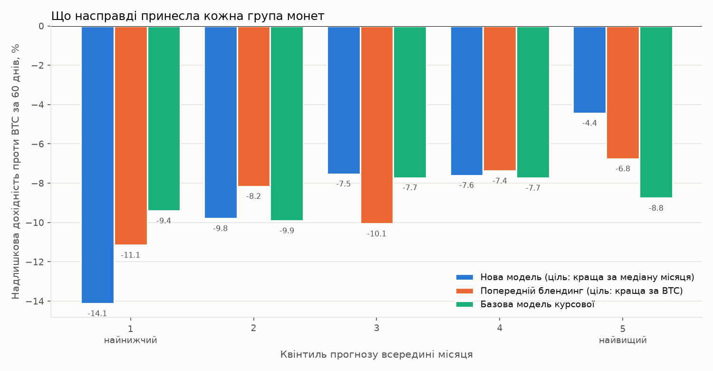
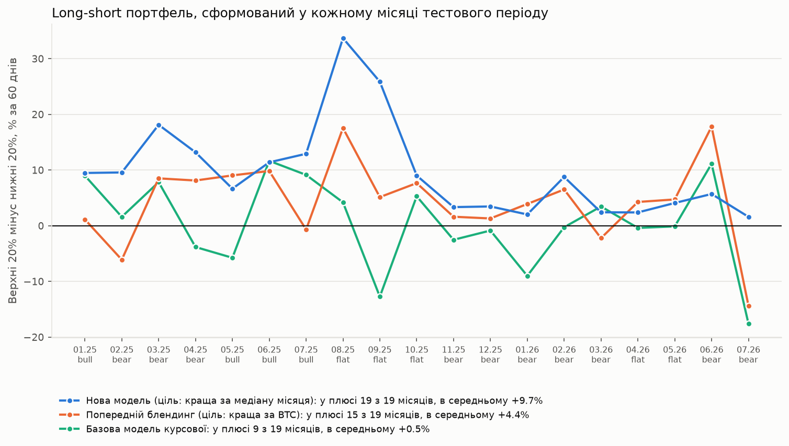
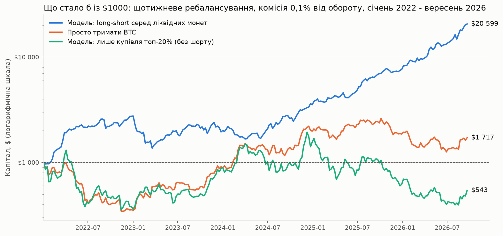

# Бонус: чи можна зробити модель, що справді працює

Курсова робота (розділ 5) навмисно залишила модель без тюнінгу: базовий
HistGradientBoostingClassifier з фіксованими гіперпараметрами, один
статичний спліт train/test за часом. Головна знахідка там була
незручна: крос-валідація на train дала ROC-AUC 0,725, а одноразовий
тест - лише 0,527, майже випадковий рівень. Причина не в помилці коду:
тестовий період (лютий-липень 2026) складався виключно з ведмежого й
бокового ринку, тоді як bull-режим, на який припадало 41% train, у
тесті не траплявся взагалі.

Це завдання перевіряє, чи можна цю проблему справді подолати, а не
просто підібрати гіперпараметри так, щоб один конкретний тест виглядав
краще. Далі описані три раунди експериментів: перший (ознаки, walk-forward
валідація, тюнінг, кроссекційна нормалізація), другий, який додав ще три
варіанти й виправив помилку першого раунду в підрахунку базової лінії, і
третій, де змінилась сама ціль навчання і з'явився бектест портфелів.
Короткий підсумок: найкращою виявилась модель із розділу "Раунд 3"; її
long-short портфель був у плюсі проти BTC у всіх 19 тестових місяцях, а
купівля лише найкращих монет досі програє BTC.

## Що змінено відносно розділу 5

Панель розширена шістьма новими ознаками, порахованими з сирої історії
Binance тим самим способом, що й в оригінальному `build_panel.py`
(виключно з даних до checkpoint, без витоку): RSI-14, MACD-гістограма
(12/26/9), позиція в смугах Боллінджера (%B, 20 днів), прискорення
моментуму (різниця 30- і 90-денної прибутковості), RSI-14 самого BTC і
кореляція денної прибутковості монети з BTC за 90 днів. Рахує це
`build_features_v2.py`, результат - `panel_v2.csv`.

Одна статична розбивка train/test замінена на purged walk-forward:
експандне вікно, сім тестових блоків по три checkpoint, з embargo в два
checkpoint перед кожним блоком, щоб 60-денне вікно таргету з train не
заходило в тестовий період. Це дає сім оцінок якості замість однієї, і
вони покривають переходи bull-bear і bear-bull, а не лише один випадково
однорідний відрізок.

Гіперпараметри підібрані один раз (RandomizedSearchCV, 40 ітерацій) на
першому році історії (2024 рік), так само як це робили б перед реальним
деплоєм, а не заднім числом на всьому датасеті.

## П'ять моделей і два блендинги

Перевірено п'ять самостійних варіантів і два способи їх поєднати.
Справжній базовий - точно той набір ознак і ті гіперпараметри
(max_iter=150, learning_rate=0.08, max_depth=4), що й у розділі 5
курсової: жодних нових ознак, жодного тюнінгу. Він потрібен як контрольна
точка, з якою порівнюється решта.

Ознаки без тюнінгу означають той самий untuned конвеєр, до якого просто
додані шість нових ознак: це ізолює ефект самих ознак від ефекту підбору
гіперпараметрів. Тюнінг і нові ознаки (v2) - те саме плюс підібрані
гіперпараметри. Кроссекційна нормалізація (v3) замінює абсолютний рівень
ознак (наприклад "+5% за 30 днів") на їхній процентильний ранг серед усіх
монет того самого checkpoint - ідея в тому, що +5% означає геть різні
речі в bull і в bear, а ранг серед ровесників того місяця відносно
стабільний. Rank-регресія (v4) навчається не на бінарному порозі
"випередила / не випередила", а на неперервному ранзі майбутньої
надлишкової дохідності монети в межах checkpoint - це задача ранжування
замість класифікації, з тим самим набором ознак, що й v2.

Блендинг - усереднення ймовірностей (для v2 і v3) або процентильних
рангів прогнозу (коли додається v4, чия шкала інша) двох чи трьох
моделей одразу.

| Варіант | Середній ROC-AUC (7 фолдів) | Стандартне відхилення |
| --- | --- | --- |
| Базовий (курсова) | 0,533 | 0,053 |
| Нові ознаки, без тюнінгу | 0,550 | 0,084 |
| Тюнінг + нові ознаки (v2) | 0,558 | 0,091 |
| Кроссекційна нормалізація (v3) | 0,521 | 0,083 |
| Rank-регресія (v4) | 0,551 | 0,047 |
| Блендинг v2+v3 | 0,574 | 0,081 |
| Блендинг v2+v3+v4 | 0,561 | 0,062 |

Дві речі тут варті окремої уваги. По-перше, справжній базовий конвеєр
курсової сам собою непогано тримається на bull-фолді (0,618) - у
попередній версії цього звіту (перший раунд, до виправлення) базовою
помилково називалась комбінація "нові ознаки без тюнінгу", яка на тому
самому фолді провалюється до 0,487 (гірше за випадковий рівень).
Справжня базова модель курсової такого провалу не має; її слабкість -
не bull, а бічний ринок (0,515-0,547).

По-друге, rank-регресія (v4) не дала найкращого середнього, зате має
найменший розкид з усіх варіантів (0,047): найгірший її фолд - 0,494,
найкращий - 0,633. Жоден інший варіант, включно з блендингами, не
тримається в такому вузькому діапазоні. Якщо мета - передбачуваність
результату, а не максимум середнього, це кращий вибір, ніж будь-який
блендинг.

## Який варіант був найкращим до раунду 3

Блендинг v2+v3 дає найвищий середній ROC-AUC (0,574 проти 0,533 у
базової моделі, приріст 0,041) і в шести з семи фолдів дорівнює або
перевершує базову модель; єдиний фолд, де він трохи гірший (2026-07,
0,440 проти 0,447), програє на 0,007 - у межах шуму. У раунді 3
з'ясувалось, що частина цього AUC бралася з вгадування загального
настрою місяця, а не з вибору монет, тож як відправну точку тепер варто
брати модель із раунду 3.

Додавання rank-регресії в блендинг (v2+v3+v4) середній результат
знижує, а не піднімає (0,561 замість 0,574), хоча й зменшує розкид.
Це означає, що v4 як самостійна модель непогана, але в цьому наборі
вона додає в блендинг більше шуму, ніж сигналу - краще лишити її
окремим варіантом для випадків, коли важливіша стабільність, а не
одночасно змішувати з v2 і v3.

## Чому це не "розв'язана" задача

Жоден з випробуваних варіантів не перетворює прогноз перспективності
монети на надійний інструмент. ROC-AUC 0,52-0,57 у середньому - це
слабкий, статистично помітний, але економічно скромний сигнал, а
найгірші фолди майже для всіх варіантів лишаються біля 0,44-0,52. Це
узгоджується з літературою, яку курсова вже цитує (Grobys та ін. про
нестабільність crypto-momentum): відносна сила монети проти ринку
працює як сигнал у одні періоди й перестає працювати в інші, і жодне
розумне ознакотворення цього не змінює, бо причина не в моделі, а в
самому ринку.

Варто також чесно назвати ризик самого цього експерименту: сім фолдів -
мала вибірка, і після перевірки семи варіантів найкращий з них майже
неминуче виглядає краще за середнє випадково, а не тільки завдяки
реальній перевазі. Приріст блендингу над базовою моделлю (0,041) не
набагато більший за типовий розкид результатів між фолдами одного й
того самого варіанту (стандартне відхилення 0,05-0,09). Це не привід
відкидати результат, але привід не оголошувати задачу розв'язаною.

Після перших двох раундів результат зводився до чесної walk-forward
оцінки, яка показує нестабільність сигналу на семи незалежних відрізках,
і скромного приросту AUC. Третій раунд показав, звідки ця нестабільність
береться: більша її частина - рух усього альт-ринку проти BTC, який
модель і не мала шансу передбачити.

## Раунд 3: вчити модель ранжувати, а не вгадувати ринок

Квінтильна перевірка показала, що навіть найкраща група монет
програвала BTC. Причина видна без жодної моделі: у тестовий період
(січень 2025 - липень 2026) середній альткоїн програвав BTC 8,7% за 60
днів, і лише в 3 з 19 місяців середня монета його обігнала. Результат
будь-якої монети проти BTC складається з двох частин: руху всього
альт-ринку проти BTC і власного відхилення монети від цього руху.
Першу частину з ознак окремої монети передбачити неможливо, а
статистично навчити її на 31 місячному спостереженні не вийде.

Ціль "краща за BTC" змішує ці дві частини. У місяць обвалу альтів
майже всі мітки нульові, у місяць альтсезону майже всі одиничні, і
такі місяці нічого не кажуть моделі про те, яка монета краща за іншу.
Тому модель перенавчена на кроссекційній цілі: чи була монета кращою
за медіанну монету свого ж місяця. Ознаки й гіперпараметри ті самі, що
у v2 і v3, змінилася лише мітка. Скрипт `strategy_backtest.py` будує
out-of-fold прогнози на тих самих 7 walk-forward фолдах і перевіряє
прості портфелі: у кожному місяці купити верхні 20% монет за прогнозом
(long-only) або купити верхні 20% і продати нижні 20% (long-short).

| Стратегія, результат проти BTC | Середнє за 60 днів | Місяців у плюсі |
| --- | --- | --- |
| Увесь ринок альтів, рівні ваги | -8,7% | 3 з 19 |
| Топ-20%, базова модель курсової | -8,8% | 3 з 19 |
| Топ-20%, попередній блендинг | -6,8% | 2 з 19 |
| Топ-20%, нова модель | -4,4% | 6 з 19 |
| Long-short, базова модель курсової | +0,5% | 9 з 19 |
| Long-short, попередній блендинг | +4,4% | 15 з 19 |
| Long-short, нова модель | +9,7% | 19 з 19 |



Рис. 1. Реальна надлишкова дохідність проти BTC за квінтилем прогнозу,
квінтилі рахуються всередині кожного місяця і потім усереднюються.

На рис. 1 видно, що базова модель курсової всередині місяця майже не
відрізняє монети: усі п'ять груп лежать між -7,7% і -9,9%. Нова модель
розводить крайні групи на 9,7 процентного пункту (-14,1% проти -4,4%).
Монотонність не ідеальна, третя й четверта групи майже однакові, тобто
модель найкраще впізнає явних аутсайдерів і явних лідерів.



Рис. 2. Результат портфеля "верхні 20% мінус нижні 20%" для кожного
місяця тестового періоду, у відсотках за 60 днів.

ROC-AUC нової моделі для цілі "краща за медіану місяця" дорівнює 0,598
(базова 0,515, попередній блендинг 0,519), і всі 7 фолдів вище 0,53.
Тут виявилась і незручна деталь про попередній раунд: ROC-AUC 0,574
попереднього блендингу частково бралося з того, що модель вгадувала
"погані місяці" загалом, а не кращі монети. Якщо рахувати лише
ранжування всередині місяця, від нього лишається 0,521.

## Перевірка на витік і на що модель ставить

Такий стрибок вимагав перевірки. Серед 15 ознак немає жодної, що
використовує дані після checkpoint; forward-вікно останнього train
checkpoint кожного фолду закінчується до першого тестового checkpoint.
Головний тест - placebo: та сама модель, навчена на мітках, перемішаних
усередині кожного train-місяця, дає rank IC 0,006 проти 0,194 у
справжньої. Отже сигнал іде зі зв'язку ознак і майбутньої дохідності, а
не з механіки конвеєра.

Сам сигнал пояснюваний. Найсильніше з майбутнім результатом монети
пов'язані волатильність (rank IC -0,18: спокійніші монети обганяють
нервові), вік монети (+0,16: свіжі лістинги після запуску зливаються)
і кореляція з BTC (+0,09). Ефект низької волатильності та слабкість
нових лістингів описані в літературі про криптовалютні фактори, тож
модель знайшла не екзотику, а відомі закономірності, і знайшла їх лише
на train-даних.

## Чого ця модель не вміє і що коштує long-short

Long-only портфель досі в мінусі проти BTC (-4,4%). Нова модель удвічі
зменшила відставання від ринку альтів, але щоб купівля альтів виходила в
плюс проти BTC, треба вгадувати, коли почнеться альтсезон, а цього з
наявних даних не навчити. Результат у плюсі дає тільки ринково-нейтральна
конструкція, де відставання всього альт-ринку скорочується між довгою і
короткою ногою.

Long-short вимагає шортити монети (на Binance це ф'ючерси), а це комісії,
фандинг і ризик раптового пампу в короткій нозі. При консервативних
витратах 2% за 60-денний період середній результат падає до +7,7%, і в
плюсі лишаються 18 з 19 місяців. Серед ліквідної половини монет (обсяг
вище медіани місяця) long-short навіть сильніший, +14,8%, тож результат
не тримається на неторгованих дрібних монетах.

Найважливіше застереження - перевага слабшає. У перші 10 тестових місяців
long-short давав у середньому +15,0%, в останні 9 лише +3,8% (мінімум
+1,6%, жодного мінуса). Після тих самих 2% витрат останні 9 місяців дають
близько +1,8%. Може, ринок звикає до цих ефектів, може, це просто шум на
малій вибірці; з 19 місяців цього не розрізнити. На половині неперекривних
місяців t-статистика 3,4, тож випадковістю весь результат пояснити важко,
але перевірено сім варіантів скору, і найкращий завжди трохи везучий. Утішає
те, що всі кроссекційні варіанти дали від +7,9% до +9,7%, а не один вдалий.

Панель містить лише монети, які торгуються на Binance сьогодні. Монети,
що померли, у дані не потрапили. Для цієї стратегії це, ймовірно, занижує
результат: померлі монети найчастіше були б серед волатильних і нових, які
модель шортить. Але величину цього ефекту без історії делістингів не
виміряти.

## Раунд 4: щотижнева модель на історії з 2021 року

Місячна панель мала 31 точку за один ринковий цикл. Щотижнева
(`build_weekly_panel.py`) починається з січня 2021 року: 298 тижнів, 384
монети, 65 820 рядків, бичачий 2021-й, ведмежий 2022-й, відновлення
2023-го і все, що було далі. Горизонт прогнозу - 7 днів, тож тестові
періоди не перекриваються і результат можна чесно компаундувати. До
ознак додались тижнева дохідність і волатильність, максимальний денний
ріст за 30 днів, бета до BTC і стан самого BTC. Ціль та сама, що в
раунді 3: краща за медіанну монету свого тижня.

`weekly_model.py` навчається лише на 2021 році, далі кожні 4 тижні
перенавчається на всіх попередніх тижнях (embargo 1 тиждень) і прогнозує
наступні 4. Гіперпараметри зафіксовані заздалегідь, на тестових тижнях
нічого не підбиралось. `weekly_portfolio.py` щонеділі перебудовує
портфель і списує 0,1% від обороту (тейкер Binance Futures плюс
прослизання); портфель щотижня майже повністю оновлюється, тож комісії
з'їдають приблизно 10% на рік.

| Стратегія, січень 2022 - вересень 2026 | Середній місяць | Місяців у плюсі | Фактичний річний | Макс. просадка |
| --- | --- | --- | --- | --- |
| Тримати BTC | +2,2% | 53% | +12% | -65% |
| Модель, лише купівля топ-20% | +1,6% | 51% | -12% | -80% |
| Модель, long-short, усі монети | +5,5% | 72% | +80% | -28% |
| Модель, long-short, ліквідні монети | +6,2% | 72% | +90% | -50% |
| Те саме, комісія 0,2% | +5,2% | 70% | +71% | -52% |



Рис. 3. Капітал із $1000 при щотижневому ребалансуванні з комісіями,
січень 2022 - вересень 2026, логарифмічна шкала.

Long-short серед ліквідних монет перетворив $1000 на приблизно $20 600
за 4,7 року; просте тримання BTC дало $1717. Sharpe 1,9. Але це не пряма
лінія: 2023 рік стратегія закінчила в мінусі (-29%), найгірший місяць
-32%, найбільша просадка -50%. Купівля лише найкращих монет без шорту
знову програє, що підтверджує висновок раунду 3: модель уміє ранжувати
монети, але не вгадує напрям ринку. Більша вага свіжих даних (період
напіврозпаду 52 тижні), яку раунд 3 пропонував спробувати, результат
погіршила (+50% річних замість +90%), тож лишилась звичайна вага.

## Звідки беруться "30-50% на місяць"

Цифри на кшталт "10 000% річних у деякі місяці" легко отримати і без
жодної помилки. Найкращий місяць простого тримання BTC (+48%) у річному
перерахунку дає понад 11 000%. Найкращий місяць стратегії "купити топ-20%"
(+87%) дає понад 180 000% річних, хоча за весь період ця стратегія
втратила майже половину грошей. Один місяць, перерахований у річні, не
каже про модель нічого.

Друге джерело - помилки бектесту. `demo_fake_backtests.py` бере ту саму
модель і ту саму симуляцію і додає по одній типовій помилці. Перша:
модель перевіряється на тих самих тижнях, на яких навчалась (in-sample).
Друга: до ознак потрапляє дохідність монети за перший день після моменту
рішення, тобто модель на один день бачить майбутнє. Таке трапляється від
банального зсуву дат на одну свічку.

| Long-short серед ліквідних монет | Середній місяць | Місяців у плюсі | $1000 перетворюються на |
| --- | --- | --- | --- |
| Чесний walk-forward | +6,2% | 72% | $20 600 |
| In-sample (перевірка на даних навчання) | +33,6% | 100% | $11 млрд |
| Підглядання на 1 день у майбутнє | +35,4% | 100% | $19 млрд |

Обидві помилки дають саме ті 30-50% на місяць без жодного збиткового
місяця. Якщо бектест будь-якої моделі показує щось подібне, спершу варто
перевірити, чи тестові дані справді не використовувались під час
навчання, і чи кожна ознака відома на момент рішення. Реальні
ринково-нейтральні фонди вважають успіхом 15-30% річних.

## Застереження до раунду 4

Survivorship bias тут сильніший, ніж у місячній панелі: з 2021 року
багато монет померло, а в даних лише ті, що торгуються сьогодні. Фандинг
ф'ючерсів не змодельований; для ринково-нейтрального портфеля він
частково взаємно гаситься, але не повністю. Не всі монети з ліквідної
половини мають ф'ючерс на Binance, тож коротка нога на практиці буде
вужчою. Прибуток 2022 року (+176%) зроблений на ведмежому ринку, де шорт
слабких альтів працював найкраще, і такий рік може не повторитися.

## Що лишається за межами цього бонусу

Дані про делістинги прибрали б survivorship bias. Для реального
використання потрібна симуляція з фактичними комісіями Binance Futures,
фандингом і списком монет, що мають ф'ючерс, а потім кілька місяців
paper trading перед будь-якими реальними грошима. Ончейн-метрики
лишаються невипробуваними.

## Як відтворити

```
python3 bonus/build_features_v2.py   # рахує panel_v2.csv з новими ознаками
python3 bonus/train_bonus_model.py   # тюнінг, walk-forward AUC, best_params.json
cd bonus
python3 strategy_backtest.py          # out-of-fold прогнози і бектест стратегій
python3 plot_strategy.py              # рис. 1 і рис. 2
python3 validate_visually.py          # квінтилі першої версії (пул за фолдами)
cd ..
python3 bonus/build_weekly_panel.py 7   # щотижнева панель з 2021 року (15 с)
python3 bonus/weekly_model.py 7         # walk-forward, приблизно 12 хвилин
python3 bonus/weekly_portfolio.py 7     # симуляція портфелів
python3 bonus/plot_weekly.py            # рис. 3
python3 bonus/demo_fake_backtests.py    # демонстрація фейкових бектестів
```

Результати: `walk_forward_report.csv` (AUC по фолдах), `oof_predictions.csv`
(усі out-of-fold прогнози), `strategy_per_checkpoint.csv`,
`long_short_by_month.csv` і `quintile_table.csv`, графіки в `figures/`.
Жоден зі скриптів у цій папці не чіпає артефакти самої курсової в `data/` і
в `Пашко_coursework.ipynb`.
